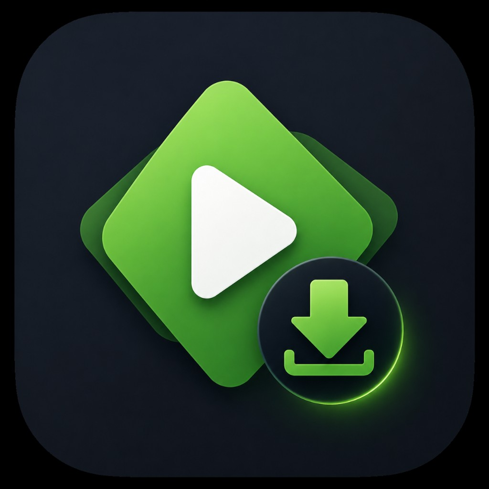
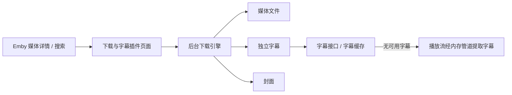

<p align="center">
  
</p>

<h1 align="center">EmbyDownload</h1>

<p align="center">
  Windows 桌面端 Emby 媒体批量下载工具<br>
  支持搜索、分集多选、断点续传，以及可选的内置代理加速
</p>

<p align="center">
  
  
  
  
  
</p>

---

## 项目简介

**EmbyDownload** 是一个基于 **JavaFX + Kotlin** 的 Windows 桌面应用，用于登录 Emby 服务器、搜索影片/音乐，并批量下载到本地或 NAS。

主要能力：

- 登录 Emby，记住多个账号
- 按关键词搜索影片 / 音乐，列表展示封面
- 剧集可按季筛选、多选分集后批量下载
- 传输队列：逐项暂停 / 继续 / 取消，失败自动重连与断点续传
- 可选 **Clash / mihomo 订阅节点**（内置 mihomo 核心），登录 / 搜索 / 下载可分别走代理
- 下载到 NAS / 网络盘时，可先写入本地 SSD 缓存，完成后再移动，减轻 SMB 边下边写的卡顿

---

## 项目背景（来源）

> 最近买了一个NAS，正好我之前有买一个Emby服务器，这个服务器可以下载影视，于是我还是从里面下载，然后上传到NAS中  
> 买了两个播放器，一个VidHub,一个CapyPlayer  
>> Vidhub：支持苹果全端，安卓端，唯独不支持Windows端  
>> CapyPlayer：支持移动端，Windows端(但目前是个假下载)，而移动端下载在内部存储目录(data)中
>>
> 由于我没有Mac，并且安卓手机存储空间不足，安卓平板VidHub下载会偶现断开连接  
> 于是诞生了本项目

---

## 环境要求

| 项目 | 说明 |
|------|------|
| 系统 | Windows（内置代理核心目前仅打包 Windows 版 mihomo） |
| 开发 / 运行 | JDK **17+**（推荐 Microsoft Build of OpenJDK 17） |
| Emby | 可访问的 Emby 服务器地址与账号 |

若使用代理下载，请将 `mihomo.exe` 放到：

```text
native/windows/mihomo.exe
```

（推荐版本见 `native/windows/README.md`，例如 `v1.19.27`。）

---

## 用法

### 开发运行

```powershell
# 按本机路径设置 JAVA_HOME
$env:JAVA_HOME = "C:\Path\To\jdk-17"

.\gradlew.bat run
```

### 便携版打包（推荐分发）

无需安装 WiX，生成可解压即用的 zip（内含 JRE 与启动 exe）：

```powershell
.\gradlew.bat packagePortable
```

输出：

```text
build/distributions/EmbyDownload-1.1.5-portable-win.zip
```

用户解压后双击 `EmbyDownload.exe` 即可。请保留整个文件夹（`app` / `runtime` / `native`），不要只拷贝单个 exe。

### 安装包（可选）

生成带向导的 Windows 安装程序需要本机安装 [WiX Toolset 3+](https://wixtoolset.org/)：

```powershell
.\gradlew.bat jpackage
```

### 日常使用流程

1. 启动应用，填写 Emby 服务器地址、用户名、密码并登录（可勾选记住账号）
2. 在首页搜索影片或音乐，点击结果进入列表
3. 勾选要下载的内容，确认后加入传输队列
4. 在「传输」页查看进度；可单条或批量暂停 / 继续 / 取消 / 删除
5. （可选）在「设置 → 代理节点」填入 Clash / mihomo 订阅 URL，获取节点并启用「登录 / 搜索 / 下载走代理」
6. 若保存目录是 NAS，建议在设置中开启「网络盘本地缓存」，缓存目录选本机 SSD

---

## 持久化数据存储位置

应用会在用户目录下写入配置与运行时文件（**不会**把密码明文写进仓库；本地以 Base64 编码保存在配置中，请注意本机安全）。

| 内容 | 路径 |
|------|------|
| 主配置（下载目录、深色模式、已保存账号、代理设置等） | `%USERPROFILE%\.embydownload\settings.json` |
| 备用 / 部分偏好（Java Preferences） | 用户 Preferences 节点 `com/dud/embydownload` |
| 内置代理配置与工作目录 | `%USERPROFILE%\.embydownload\`（含 `mihomo-config.yaml`、`mihomo\` 等） |
| 代理运行日志 | `%USERPROFILE%\.embydownload\mihomo.log` |
| 网络盘本地缓存（默认） | `%LOCALAPPDATA%\EmbyDownload\staging\` |
| 默认下载目录 | `%USERPROFILE%\Downloads\EmbyDownload\`（可在设置中修改） |

说明：

- 下载到 NAS 且开启本地缓存时：文件先落到「本地缓存目录」，完成后再移动到你设置的下载目录
- 清除本机配置可删除 `%USERPROFILE%\.embydownload\`（并视需要清理 Preferences 与 staging 目录）

---

## Emby Theater 插件

Windows 版 Emby Theater 的 Electron 客户端可以直接使用下载页面，入口位于顶部下载按钮、媒体详情页和播放设置中的「下载与字幕」。后台复用下载引擎，不打开单独的下载器窗口，登录使用客户端当前会话。

支持影片、分集和音乐批量传输，以及独立保存字幕和封面。文本字幕保留 ASS、SSA、SRT、VTT 格式；内嵌 PGS 字幕导出为 SUP，其它图形字幕使用 MKS。每项任务可以暂停、继续、取消和重试。原文件下载与直接播放缓存分别使用对应服务器接口。

文本字幕优先使用服务器提供的字幕链接，并兼容带起始时间的字幕接口。接口返回 404 且没有有效字幕缓存时，自动从直接播放流提取。播放流通过内存管道送入 FFmpeg，只输出字幕，不保存或缓存视频文件。传输页显示读取播放流的进度。

播放流提取为每条字幕轨道单独读取完整媒体输入，因此只保存字幕也会产生相应的媒体流量。自动重试会从头读取当前轨道，已完成轨道保留。源读取进度与字幕大小分别显示，字幕大小在输出缓冲刷新前可能保持为零。

保存后保留同一账号、媒体版本和轨道的文本字幕缓存，后续接口不可用时可直接复用。缓存只包含字幕，插件保存在 `electronapp/plugins/embydownload/subtitle-cache`，独立应用保存在已配置缓存目录的 `subtitles` 子目录。



构建插件包：

```powershell
.\gradlew.bat packageTheater
```

解压 `build/distributions/EmbyDownload-1.1.5-theater-plugin-win.zip`，关闭 Emby Theater，再在解压目录执行：

```powershell
powershell -ExecutionPolicy Bypass -File .\install\Install-TheaterPlugin.ps1 -ClientDirectory "D:\Apps\Emby Theater"
```

将路径替换为包含 `Emby.Theater.exe` 和 `electronapp` 的安装目录。安装器添加本地插件和后台运行时，并在 `electronapp/preload.js` 加入下载连接加载语句。客户端下载设置继续使用 `%USERPROFILE%\.embydownload\settings.json`。客户端升级覆盖插件或 preload 时，重新运行安装器即可。

播放流和本地媒体字幕提取使用本机 FFmpeg。安装器会使用 PATH 中的 `ffmpeg.exe`，也可以传入 `-FFmpegPath "D:\Tools\FFmpeg\ffmpeg.exe"`。仅选择字幕时不会生成视频文件；如已有对应媒体，可在页面填入本地文件完整路径，并只选择对应的一个条目，直接提取而不重复读取网络播放流。

---

## 技术栈

- Kotlin / Java 17
- JavaFX 21
- Gradle（`org.openjfx.javafxplugin`、`org.beryx.jlink`）
- Gson、SnakeYAML
- 可选内置 [mihomo](https://github.com/MetaCubeX/mihomo)（Clash Meta）作为代理核心

---

## 目录结构（简要）

```text
EmbyDownload/
├── packaging/           # 图标与打包资源（app-icon.png / .ico）
├── native/windows/      # 内置 mihomo.exe（需自行放入）
├── src/main/kotlin/     # 应用逻辑
└── src/main/resources/  # FXML、样式、窗口图标
```

---

## 许可证

本项目采用 [**GNU General Public License v3.0 (GPL-3.0)**](LICENSE)。

这意味着：

- 你可以自由使用、修改、分发本软件
- **若对外分发修改后的版本**（含二进制），必须继续以 GPL-3.0（或兼容许可）开源，并提供对应源代码
- 不能把本项目改成闭源后再分发

完整条款见仓库根目录 [`LICENSE`](LICENSE)。

> 使用时请自行遵守 Emby 服务条款，以及内置 / 依赖组件（如 mihomo）各自的许可证要求。

---

## 致谢

- [Emby](https://emby.media/)
- [mihomo / Clash Meta](https://github.com/MetaCubeX/mihomo)
- JavaFX / Kotlin / Gradle 生态
